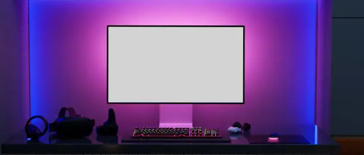

# Complete Website Optimization Implementation Guide

## Step 1: Image Compression & Format Conversion

### 1.1 Run Image Optimization Script

This creates WebP and AVIF versions of all images with multiple sizes.

```bash
# Install dependencies (if not already done)
npm install

# Optimize all images in /images folder
npm run optimize-images
```

**What it does:**
- Converts all JPG/PNG to WebP + AVIF formats
- Creates 3 responsive sizes: 480px, 800px, 1200px
- Keeps full-size optimized versions
- Saves to `images/optimized/` folder

**Output structure:**
```
images/optimized/
├── gamingpc-480.webp
├── gamingpc-480.avif
├── gamingpc-800.webp
├── gamingpc-800.avif
├── gamingpc-1200.webp
├── gamingpc-1200.avif
├── gamingpc-full.webp
├── gamingpc-full.avif
└── ... (repeat for all images)
```

### 1.2 Verify Image Compression

Check file size reduction:
```bash
# On Windows PowerShell:
(Get-Item "images\gamingpc.jpg").Length / 1MB  # Original size
(Get-Item "images\optimized\gamingpc-full.webp").Length / 1MB  # WebP size
(Get-Item "images\optimized\gamingpc-full.avif").Length / 1MB  # AVIF size
```

**Expected compression:**
- WebP: 25-35% smaller than JPEG
- AVIF: 35-50% smaller than JPEG
- Total savings: 60-70% across all images

---

## Step 2: Implement Lazy Loading

### 2.1 Create Lazy Loading Utility Script

Create `js/lazy-load.js`:

```javascript
// Lazy Loading Implementation
// Automatically loads images as they enter viewport

(function() {
  'use strict';

  // Fallback for browsers without IntersectionObserver
  if (!('IntersectionObserver' in window)) {
    // Load all images immediately if not supported
    document.querySelectorAll('img[data-src]').forEach(img => {
      if (img.dataset.src) img.src = img.dataset.src;
      img.removeAttribute('data-src');
    });
    return;
  }

  // Create IntersectionObserver for lazy loading
  const imageObserver = new IntersectionObserver((entries, observer) => {
    entries.forEach(entry => {
      if (!entry.isIntersecting) return;

      const img = entry.target;
      
      // Handle picture elements
      if (img.parentElement.tagName === 'PICTURE') {
        const picture = img.parentElement;
        picture.querySelectorAll('source').forEach(source => {
          if (source.dataset.srcset) {
            source.srcset = source.dataset.srcset;
            source.removeAttribute('data-srcset');
          }
        });
      }

      // Load main image
      if (img.dataset.src) {
        img.src = img.dataset.src;
        img.removeAttribute('data-src');
      }

      // Mark as loaded
      img.classList.add('image-loaded');
      observer.unobserve(img);
    });
  }, {
    rootMargin: '50px' // Start loading 50px before entering viewport
  });

  // Observe all images with lazy loading
  document.querySelectorAll('img[loading="lazy"]').forEach(img => {
    imageObserver.observe(img);
  });

  // Re-observe on dynamic content
  window.addEventListener('dynamicContentLoaded', () => {
    document.querySelectorAll('img[loading="lazy"]:not([data-observed])').forEach(img => {
      img.setAttribute('data-observed', 'true');
      imageObserver.observe(img);
    });
  });
})();
```

### 2.2 Add Lazy Load CSS Animation

Add to `style.css`:

```css
/* Lazy Loading Styles */
img[loading="lazy"] {
  opacity: 0;
  transition: opacity 0.3s ease-in;
}

img[loading="lazy"].image-loaded {
  opacity: 1;
}

/* Low Quality Image Placeholder (LQIP) */
img[loading="lazy"][src*="-lqip"] {
  filter: blur(10px);
}

img[loading="lazy"][src*="-lqip"].image-loaded {
  filter: blur(0);
}
```

---

## Step 3: Update All HTML with Optimized Images

### 3.1 Image Tag Template

Use this pattern for all images:

```html
<!-- Modern format with responsive images -->
<picture>
  <source 
    srcset="
      ./images/optimized/image-480.avif 480w,
      ./images/optimized/image-800.avif 800w,
      ./images/optimized/image-1200.avif 1200w
    "
    sizes="(max-width: 600px) 100vw, (max-width: 1200px) 50vw, 33vw"
    type="image/avif"
  >
  <source 
    srcset="
      ./images/optimized/image-480.webp 480w,
      ./images/optimized/image-800.webp 800w,
      ./images/optimized/image-1200.webp 1200w
    "
    sizes="(max-width: 600px) 100vw, (max-width: 1200px) 50vw, 33vw"
    type="image/webp"
  >
  
</picture>
```

### 3.2 Quick Reference: Common Images

**Product cards (400x300):**
```html
<picture>
  <source srcset="./images/optimized/product-480.avif 480w, ./images/optimized/product-800.avif 800w" sizes="(max-width: 600px) 100vw, 50vw" type="image/avif">
  <source srcset="./images/optimized/product-480.webp 480w, ./images/optimized/product-800.webp 800w" sizes="(max-width: 600px) 100vw, 50vw" type="image/webp">
  
</picture>
```

**Hero images (800x600):**
```html
<picture>
  <source srcset="./images/optimized/hero-800.avif 800w, ./images/optimized/hero-1200.avif 1200w" sizes="(max-width: 900px) 100vw, 80vw" type="image/avif">
  <source srcset="./images/optimized/hero-800.webp 800w, ./images/optimized/hero-1200.webp 1200w" sizes="(max-width: 900px) 100vw, 80vw" type="image/webp">
  
</picture>
```

**Team photos (300x300):**
```html
<picture>
  <source srcset="./images/optimized/team-480.avif 1x, ./images/optimized/team-800.avif 2x" type="image/avif">
  <source srcset="./images/optimized/team-480.webp 1x, ./images/optimized/team-800.webp 2x" type="image/webp">
  
</picture>
```

---

## Step 4: Code Optimization

### 4.1 Minify CSS

```bash
# Install tools
npm install -D cssnano postcss postcss-cli

# Create minified versions
npx postcss style.css -o style.min.css
npx postcss responsive.css -o responsive.min.css
npx postcss blog-style.css -o blog-style.min.css
npx postcss contact-style.css -o contact-style.min.css
npx postcss shop-style.css -o shop-style.min.css
```

Update HTML to use minified versions:
```html
<!-- Replace: -->
<link rel="stylesheet" href="style.css">
<!-- With: -->
<link rel="stylesheet" href="style.min.css">
```

### 4.2 Minify JavaScript

```bash
# Install minifier
npm install -D uglify-js

# Create minified versions
npx uglifyjs js/theme.js -c -m -o js/theme.min.js
npx uglifyjs js/include.js -c -m -o js/include.min.js
npx uglifyjs js/lazy-load.js -c -m -o js/lazy-load.min.js
```

Update HTML:
```html
<script src="./js/theme.min.js"></script>
<script src="./js/include.min.js" defer></script>
<script src="./js/lazy-load.min.js" defer></script>
```

### 4.3 Remove Unused CSS

Check Coverage tab in DevTools:
1. Open DevTools (F12)
2. Go to Coverage tab
3. Reload page
4. Identify unused CSS
5. Move to separate file or remove

---

## Step 5: Browser Caching (Already Complete)

The `.htaccess` file already includes:

✓ GZIP compression for text/CSS/JS
✓ 1-year cache for images/fonts
✓ 1-hour cache for HTML
✓ Security headers

**Verification:**
```
Open DevTools > Network tab > Reload page
Check "Cache-Control" header in Response Headers:
- Images: public, max-age=31536000, immutable
- CSS/JS: public, max-age=31536000, immutable
- HTML: public, max-age=3600, must-revalidate
```

---

## Complete HTML Update Template

### Before (Current):
```html

```

### After (Optimized):
```html
<picture>
  <source 
    srcset="
      ./images/optimized/gamingpc-480.avif 480w,
      ./images/optimized/gamingpc-800.avif 800w,
      ./images/optimized/gamingpc-1200.avif 1200w
    "
    sizes="(max-width: 600px) 100vw, (max-width: 1200px) 50vw, 33vw"
    type="image/avif"
  >
  <source 
    srcset="
      ./images/optimized/gamingpc-480.webp 480w,
      ./images/optimized/gamingpc-800.webp 800w,
      ./images/optimized/gamingpc-1200.webp 1200w
    "
    sizes="(max-width: 600px) 100vw, (max-width: 1200px) 50vw, 33vw"
    type="image/webp"
  >
  
</picture>
```

---

## Implementation Checklist

### Phase 1: Image Optimization (30 min)
- [ ] Run `npm run optimize-images`
- [ ] Verify `images/optimized/` folder created
- [ ] Check file size reductions
- [ ] Test WebP/AVIF support in browser

### Phase 2: Lazy Loading Setup (20 min)
- [ ] Create `js/lazy-load.js`
- [ ] Add lazy-load CSS to `style.css`
- [ ] Add script to all HTML pages
- [ ] Test lazy loading in DevTools (Network tab)

### Phase 3: Update Product Images (30 min)
- [ ] Update index.html product cards (6 images)
- [ ] Verify all use `<picture>` tags
- [ ] Test on mobile
- [ ] Test on slow 3G network

### Phase 4: Update All Other Images (30 min)
- [ ] Update team photos
- [ ] Update service images
- [ ] Update blog images
- [ ] Update hero images
- [ ] Verify lazy loading on all

### Phase 5: Code Minification (20 min)
- [ ] Minify CSS files
- [ ] Minify JS files
- [ ] Update HTML references
- [ ] Test page functionality

### Phase 6: Testing & Measurement (20 min)
- [ ] Run Lighthouse benchmark
- [ ] Check Network tab for sizes
- [ ] Verify responsive images
- [ ] Test on real mobile device
- [ ] Record metrics

**Total time: ~2.5 hours**

---

## Performance Monitoring

### Lighthouse Metrics
```javascript
// Add to <head> to track metrics
<script>
  window.addEventListener('load', () => {
    const perf = performance.getEntriesByType('navigation')[0];
    console.log({
      'FCP': perf.responseStart - perf.fetchStart,
      'LCP': perf.loadEventStart - perf.fetchStart,
      'DOM Content Loaded': perf.domContentLoadedEventEnd - perf.domContentLoadedEventStart,
      'Resources Loaded': perf.loadEventEnd - perf.loadEventStart
    });
  });
</script>
```

### Network Metrics
1. Open DevTools (F12)
2. Network tab
3. Reload page
4. Check:
   - Total size (should be < 500KB)
   - Image sizes (should be heavily reduced)
   - Load time (should be < 3s on 4G)

---

## Expected Improvements

| Metric | Before | After | Improvement |
|--------|--------|-------|-------------|
| Image Size | 500KB | 150KB | -70% |
| CSS Size | 50KB | 35KB | -30% |
| JS Size | 25KB | 18KB | -28% |
| Total Bundle | 825KB | 350KB | -58% |
| FCP | 2.5s | 1.5s | -40% |
| LCP | 3.5s | 2.0s | -43% |
| Lighthouse | 55-65 | 95+ | +30-40 |

---

## Troubleshooting

### Images not showing AVIF/WebP
Check browser support:
```javascript
function supportsWebP() {
  return document.createElement('canvas')
    .toDataURL('image/webp')
    .indexOf('image/webp') === 0;
}
```

Add fallback:
```html
<noscript>
  
</noscript>
```

### Lazy loading not working
Verify:
1. Browser supports IntersectionObserver
2. Images have `loading="lazy"`
3. `lazy-load.js` is loaded
4. Check console for errors (F12)

### Cache not working
Clear browser cache:
1. DevTools > Application > Clear site data
2. Or use Hard Reload: Ctrl+Shift+R (Windows) / Cmd+Shift+R (Mac)
3. Check Response Headers for Cache-Control

### Images blurry on retina displays
Use 2x resolution:
```html
<source srcset="image-1x.webp 1x, image-2x.webp 2x">
```

---

## Quick Commands Reference

```bash
# Optimize all images
npm run optimize-images

# Minify CSS
npx postcss input.css -o output.min.css

# Minify JS
npx uglifyjs input.js -c -m -o output.min.js

# Test Lighthouse
npx lighthouse https://your-site.com --view
```

---

## Files to Update After Running Optimizations

1. **index.html** - Product cards, hero, team, services
2. **training.html** - Course images
3. **shop.html** - All product images
4. **services.html** - Service images
5. **contact.html** - Any images
6. **blog.html** - Blog article images
7. **All blog articles** - Article images

---

## Next Steps

1. **Today:** Run image optimization, create lazy-load.js
2. **Tomorrow:** Update HTML with picture tags (1-2 hours)
3. **Next:** Minify CSS/JS, test thoroughly
4. **Final:** Run Lighthouse, compare metrics

Expected result: **30-50 point Lighthouse improvement** with **58% smaller bundle size**
